<!--
  Profile README for github.com/Simon-Njoroge
  The figures in ./assets are drawn by the scripts in ./tools (plain SVG + CSS, no JavaScript, so GitHub renders them).
  Each one has a light and a dark version; <picture> picks the one that matches the reader's theme.
  Keep the repo name equal to the username (Simon-Njoroge/Simon-Njoroge) for this file to show on the profile.
-->

<p align="center">
  <picture>
    <source media="(prefers-color-scheme: dark)" srcset="./assets/banner-dark.svg" />
    
  </picture>
</p>

I build machine learning systems that ship: retrieval-augmented LLM pipelines, model fine-tuning and evaluation, and the FastAPI + React products that put them in front of users. Based in Nairobi, working on AI for African markets.

**Now** &nbsp;·&nbsp; Lead Systems Engineer at Nyakezi Global, building an AI-assisted legal platform for Kenya: document intelligence over case law, structured drafting, and evaluation harnesses so the models stay honest.

**Before** &nbsp;·&nbsp; BSc Computer Science (Kirinyaga University); mobile and web engineering at eMobilis and Teach2Give; Microsoft AI Fundamentals certified.

```text
  question ──> retrieve ──> draft ──> evaluate ──> answer
                  │                       │
              case law               eval harness,
              + vectors              keeps it honest
```

<p align="center">
  <picture>
    <source media="(prefers-color-scheme: dark)" srcset="./assets/attention-dark.svg" />
    
  </picture>
</p>

### What I work with

| Area | Tools |
|---|---|
| Modelling | PyTorch · scikit-learn · Hugging Face Transformers · PEFT / LoRA |
| LLM systems | LangChain · vector search (pgvector, FAISS) · prompt & eval pipelines · OpenAI / Anthropic APIs |
| Data | Python · pandas · NumPy · PostgreSQL · MySQL |
| Serving | FastAPI · Docker · Node.js · GitHub Actions |
| Product | React · TypeScript · React Native · Tailwind |

### Currently learning

- Reinforcement learning from feedback for domain-specific assistants
- Efficient inference: quantisation and serving small models on modest hardware
- Kiswahili and Sheng NLP: low-resource language data and evaluation

### Let's talk

[mukirisimon22@gmail.com](mailto:mukirisimon22@gmail.com) &nbsp;·&nbsp; [LinkedIn](https://www.linkedin.com/in/youngdeveloper) &nbsp;·&nbsp; [dev.to/dev_simon](https://dev.to/dev_simon)

<p align="center">
  <picture>
    <source media="(prefers-color-scheme: dark)" srcset="https://github-readme-stats-theta-eight-23.vercel.app/api?username=Simon-Njoroge&show_icons=true&hide_border=true&bg_color=161614&title_color=F0EEE6&text_color=B0AEA5&icon_color=D97757&border_radius=14" />
    
  </picture>
  <picture>
    <source media="(prefers-color-scheme: dark)" srcset="https://github-readme-stats-theta-eight-23.vercel.app/api/top-langs?username=Simon-Njoroge&layout=compact&hide_border=true&bg_color=161614&title_color=F0EEE6&text_color=B0AEA5&border_radius=14" />
    
  </picture>
</p>

<p align="center">
  
</p>

<p align="center">
  <sub>The banner and the figure are drawn in code: see <a href="./tools">tools/</a>. Name set in Newsreader.</sub>
</p>
